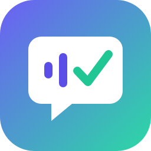
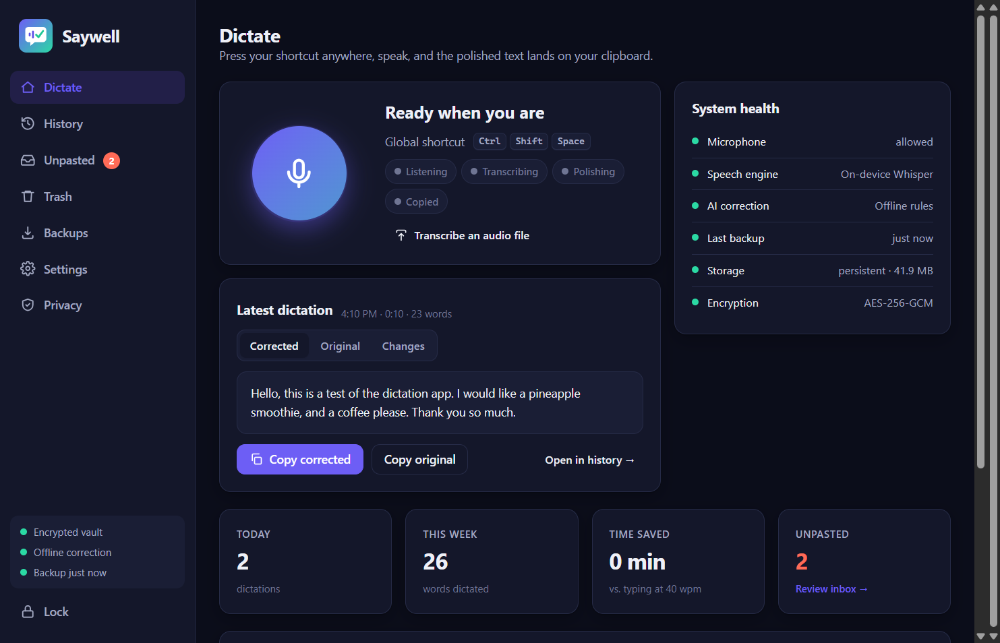
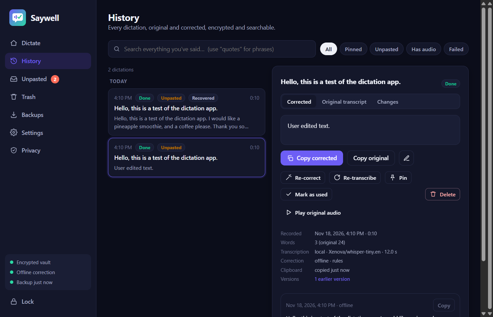
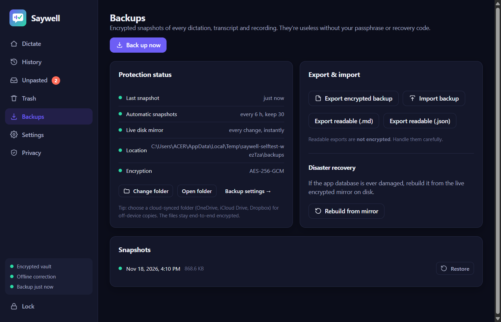

<p align="center"></p>

<h1 align="center">Saywell</h1>

<p align="center">
  <a href="../../actions/workflows/ci.yml"></a>
  
  
</p>

**Say it. Paste it. Never lose it.** A private AI voice dictation app. Press a shortcut anywhere, speak, and get grammar-corrected text that keeps your tone, already on your clipboard. Every recording and transcript is encrypted, backed up and searchable forever.

Built from [`MASTER_PROMPT.md`](MASTER_PROMPT.md), the full product and engineering brief.

<p align="center"></p>

| History & search | Backups |
|---|---|
|  |  |

## Quick start

```bash
git clone <this repo> saywell && cd saywell
npm install          # also bundles browser vendor files into www/vendor
npm start            # desktop app (Electron): global shortcuts, tray, overlay
npm run web          # browser/PWA version at http://localhost:5178
npm test             # unit tests (crypto, cleanup, diff, prompt)
npm run selftest     # end-to-end test in a throwaway profile (real Whisper + pipeline)
```

On first launch you create a passphrase and receive a **recovery code**. Store the code safely: it's the only way back in if you forget the passphrase.

| Default shortcut | Action |
|---|---|
| `Ctrl/Cmd + Shift + Space` | Start / stop dictation (works from any app on desktop) |
| `Ctrl/Cmd + Alt + V` | Copy the last dictation again |

Both can be changed in **Settings → Shortcuts**.

### Turn on AI correction
Go to **Settings → AI correction** and paste an Anthropic API key (console.anthropic.com). The default model is `claude-opus-5-5`; Haiku 5.5 is the fastest option. Requests use the official `@anthropic-ai/sdk` with low effort for speed, plus server-side refusal fallback. Without a key, or when offline, Saywell uses its offline cleaner automatically, so you always get text.

### Transcription engines
- **On-device Whisper (default):** private and offline after a one-time model download (Tiny 40 MB to Small 250 MB).
- **Cloud, OpenAI-compatible:** OpenAI `whisper-1` / `gpt-4o-transcribe`, Groq, or a self-hosted server.
- **Browser speech:** Chrome web version only.

## How "nothing is ever lost" works
1. **Chunked persistence:** audio is saved encrypted every second while you speak.
2. **Durable pipeline:** `recording → recorded → transcribing → transcribed → correcting → done`. Each step is committed before the next one starts. After a crash, `recover()` finishes anything left unfinished.
3. **Original ≠ corrected:** the raw transcript is never overwritten. Edits and re-corrections are kept as versions.
4. **Desktop live mirror:** every encrypted record is also written atomically to `%APPDATA%/Saywell/mirror`, so the database can be rebuilt from it.
5. **Snapshots:** rotating encrypted `.swbk` backups (every 6 h by default, newest 30 kept) go to a folder you choose. A cloud-synced folder works well.
6. **Close ≠ quit:** closing the window hides Saywell to the tray, a crashed renderer auto-reloads, and only one instance runs.
7. **Unpasted inbox, tray "Recent dictations" and re-copy shortcut:** for text you forgot to paste.
8. **Trash:** deleted items are kept 30 days by default (configurable).

## Security model
- AES-256-GCM for all content, with a random data key and a unique IV per write. Ciphertext is bound to the record id (AAD).
- The data key is wrapped with AES-KW under PBKDF2-SHA-256 (600k iterations) from your passphrase, and separately from your recovery code. Optionally it is also protected by the OS keychain (Electron `safeStorage`) for auto-unlock.
- API keys live inside the encrypted settings. No telemetry. No Saywell server.
- Electron: `contextIsolation`, `sandbox`, no Node in the renderer, strict CSP, a custom `app://` protocol with traversal protection, mic-only permission handler, blocked navigation and popups.
- Auto-lock on idle, "Erase everything", per-item delete, retention controls, plaintext export only after confirmation.

The self-test checks that no plaintext appears in IndexedDB, the disk mirror or backup files.

## Mobile (Capacitor)
The same `www/` runs on Android and iOS.

```bash
npm run mobile:android   # already generated in ./android; then: npx cap open android
npm run mobile:ios       # macOS + Xcode required; then: npx cap open ios
```
`scripts/mobile-permissions.js` adds `RECORD_AUDIO` (Android) and `NSMicrophoneUsageDescription` (iOS), and disables Android auto-backup of the encrypted database. On phones you dictate with the mic button; the clipboard uses `@capacitor/clipboard` and backups go to `Documents/Saywell`.

## Project layout
```
MASTER_PROMPT.md        product + engineering brief
www/                    the app (shared by web, desktop, mobile)
  js/core/              crypto, vault, db, store, recorder, pipeline, stt, correct, backup, platform
  js/ui/                dashboard, history/inbox/trash, backups, settings/privacy, auth
  assets/               logo + icons
electron/               desktop shell (main.js, preload.cjs)
android/                Capacitor Android project
scripts/                vendor bundling, icons, self-test, mobile permissions
tests/                  unit tests, self-test fixture + screenshots
server.js               local web server with security headers
```

## Contributing & security
See [CONTRIBUTING.md](CONTRIBUTING.md). Report vulnerabilities privately as described in [SECURITY.md](SECURITY.md).

## License
[MIT](LICENSE)
